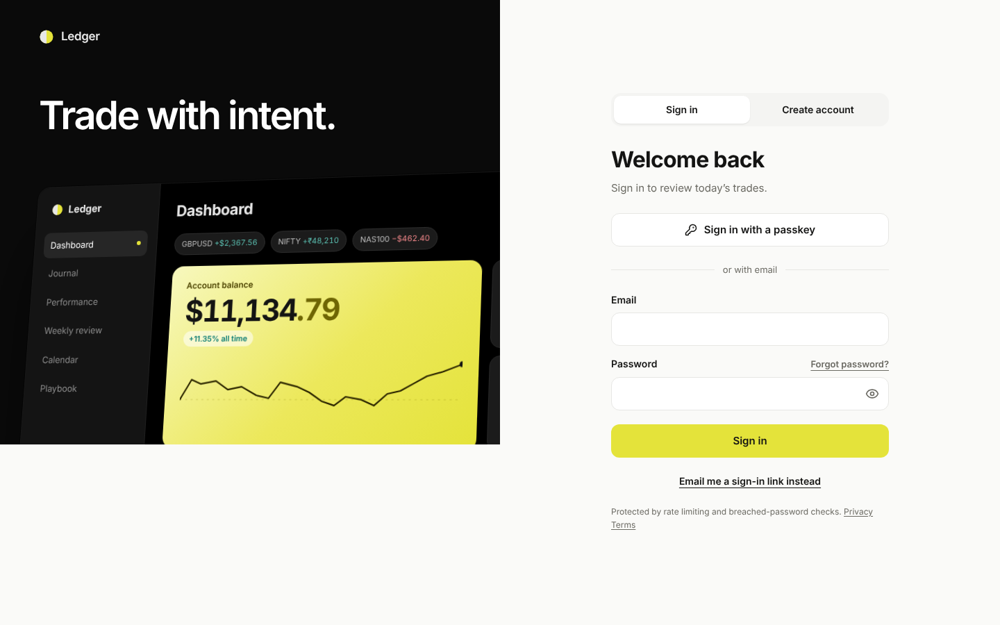
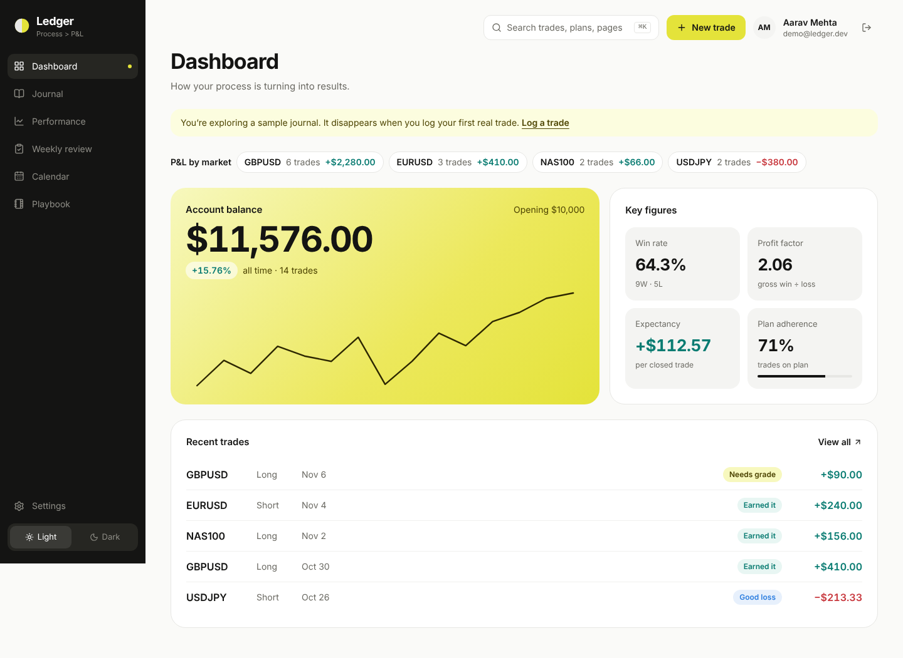
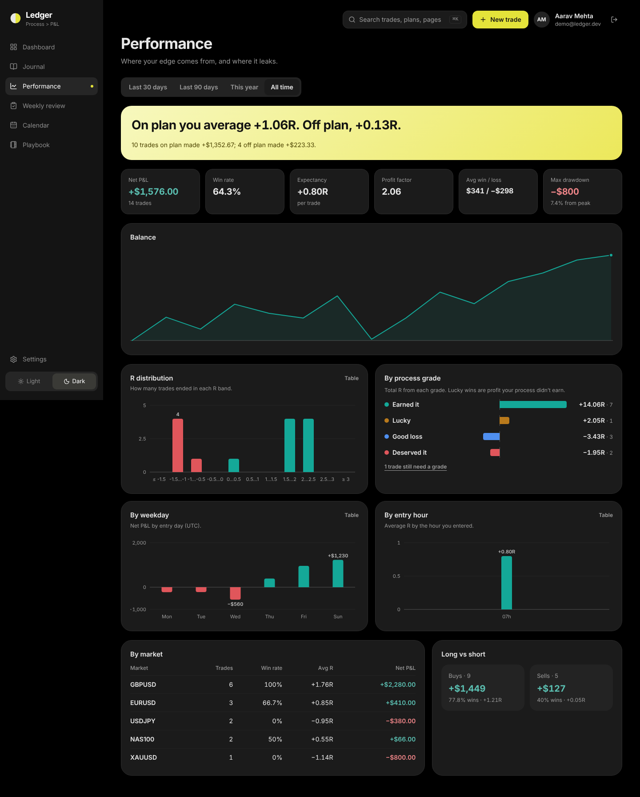
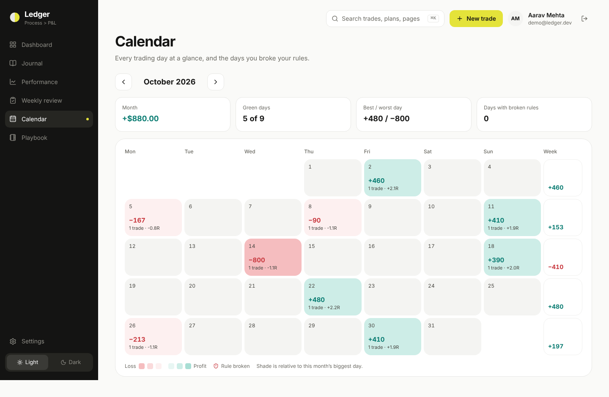
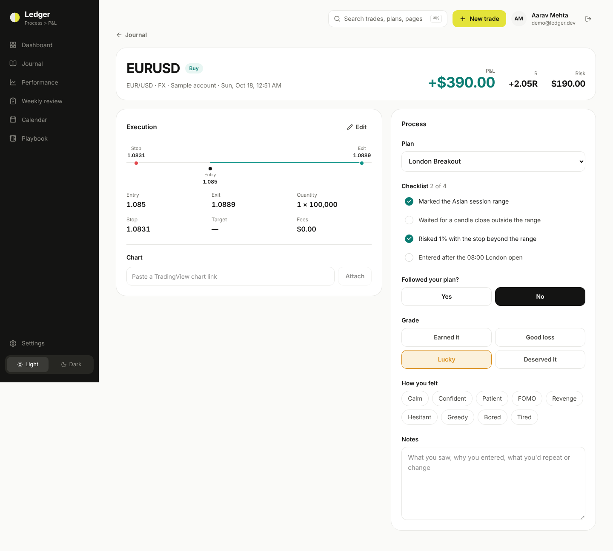
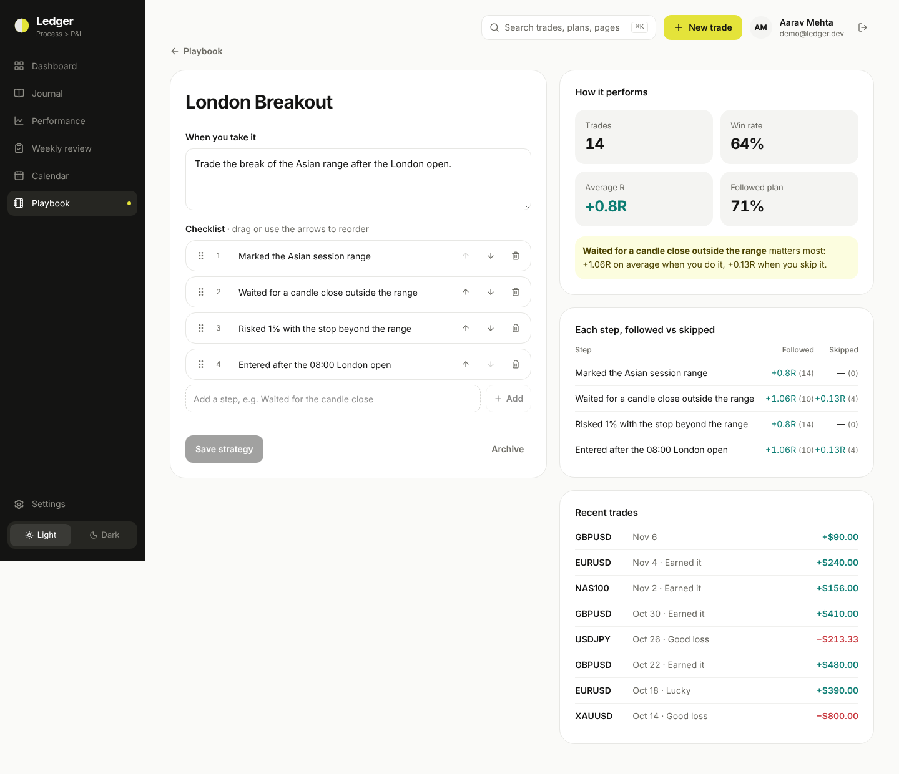
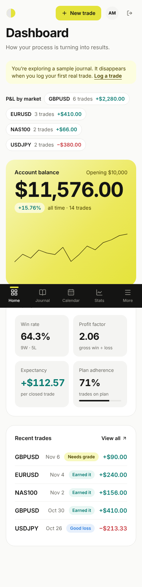

# Ledger

A trading journal that grades your **process**, not just your P&L. Log trades from any market (NSE, NASDAQ, FX, crypto), set rules for yourself, and see whether your results came from following the plan or from luck.

> Portfolio project by Yash Salokhe. Designed in Figma, built with Next.js 16, PostgreSQL and Better Auth.

| | |
|---|---|
|  |  |
|  |  |
|  |  |

<p align="center"></p>

## What it does

- **Process grades.** Every trade is *Earned it*, *Good loss*, *Lucky* or *Deserved it*, so a winning trade that broke the plan never inflates your stats.
- **Rules you can't quietly break.** Set a max trades per day, a daily loss limit, a trading window or a risk cap. When you hit one, **New trade locks**. You can override it for the day in Settings, but Ledger warns you and records the override in your weekly review.
- **Any market.** Instruments carry their exchange (ISO 10383), asset class, currency and lot size. Each trading account has its own currency; INR uses lakh grouping.
- **Ledger Coach** (in progress): an AI that reads your journal through read-only views and answers questions like "Why did September lose?".

## Stack

| Layer | Choice | Why |
|---|---|---|
| Web | Next.js 16 (App Router, Cache Components, Partial Prerendering) | Static shell from the CDN, data streams in. ~6 ms TTFB locally |
| UI | Tailwind v4 with tokens from the Figma Foundations, Motion | One source of truth for light and dark themes |
| Auth | Better Auth (self-hosted) | Email + password, Google, Apple, magic link, passkeys, email codes; no per-user fees, data stays in our DB |
| Database | PostgreSQL 16 + Drizzle ORM | Row-level security, numeric money, JSONB, triggers |
| Pooling | PgBouncer (transaction mode) | Thousands of app connections → ~20 DB connections |

Full design: **[docs/ARCHITECTURE.md](docs/ARCHITECTURE.md)** (app flow, data model, security, scaling, storage, performance).

## Run locally

```bash
cp .env.example .env.local          # fill BETTER_AUTH_SECRET (openssl rand -base64 32)
docker compose up -d postgres       # Postgres 16 on :5432
npm install
npm run db:migrate                  # schema, RLS, roles, coach views, instruments
npm run dev                         # http://localhost:3000
```

Emails (verification codes, magic links) print to the terminal until `RESEND_API_KEY` is set.

## Scripts

| | |
|---|---|
| `npm run dev` / `build` / `start` | Next.js |
| `npm test` | Unit tests (rules engine, P&L maths) |
| `npm run test:db` | Integration tests against Postgres with RLS (server actions, rules, concurrency, isolation) |
| `npm run typecheck` / `lint` | TypeScript, ESLint |
| `npm run db:generate` / `db:migrate` | Drizzle migrations |
| `node scripts/screenshots.mjs …` | Render pages of a running build in headless Chrome (visual check) |

## Deploy

`Dockerfile` builds a standalone image (non-root, healthcheck at `/api/health`). See the hosting section of the architecture doc for where to run it. For Indian users, keep the app and database in an India region.

## Status

| Screen (Figma) | Status |
|---|---|
| Sign in, sign up, verify, reset | ✅ |
| Dashboard | ✅ |
| New trade (with rules) | ✅ |
| Journal | ✅ |
| Settings: account, rules, override, export | ✅ |
| Trade review (grade, checklist, emotions, notes autosave, edit numbers, chart link) | ✅ |
| Playbook + strategy detail, Calendar, Performance | ✅ |
| Weekly review (rules broken + overrides with reasons, reflection autosave, last week's focus) | ✅ |
| CSV import (MetaTrader 5, Zerodha tradebook with FIFO pairing, any CSV with column mapping) | ✅ |
| ⌘K search (trades by market or note words, strategies, pages) | ✅ |
| Broker API sync, Ledger Coach + MCP | Next |
