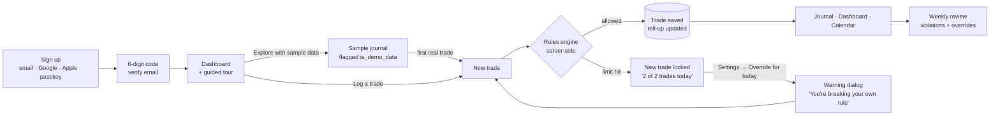
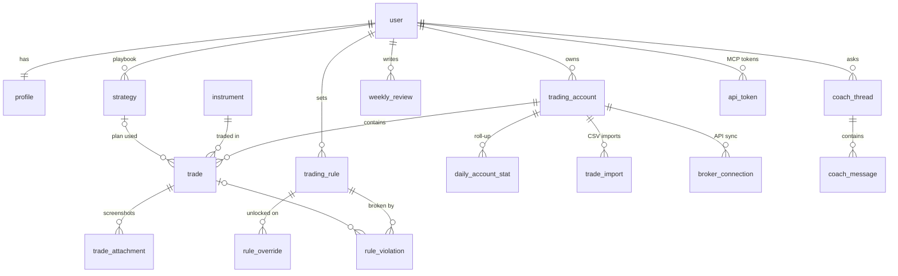
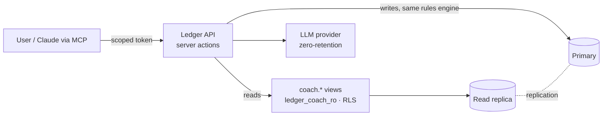
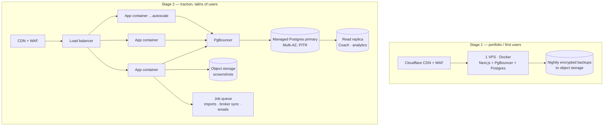

# Ledger — Architecture

How Ledger works end to end: the app flow, the data model, security, the database design, how it handles traffic, where data is stored, what is stored, and how it stays fast.

*Last updated: 7 Nov 2026. Covers the code in this repository. Items marked † are designed and documented here but ship with the feature named next to them.*

---

## 1. Decisions at a glance

| Question | Decision | Why |
|---|---|---|
| Database | **PostgreSQL 16** (one primary, read replicas later) | Relational data (accounts → trades → rules), exact `numeric` money, row-level security, JSONB for checklists, triggers for roll-ups. One well-tuned Postgres serves lakhs of users for this workload (see §7). |
| Where data lives | **App and database in the same region, close to users.** Indian users → an India region (Mumbai/Bengaluru). | Every page needs 2–6 queries. If the database is an ocean away, each query adds 120–250 ms. |
| IONOS | Fine for a portfolio demo or EU users. **Not the right primary for lakhs of Indian users**: IONOS has no data centre in India (US, Germany, UK, Spain, France only). | Latency, see §7.4. The app ships as a Docker image, so it can move without code changes. |
| How MCP / Ledger Coach reads data | **Neither base tables nor a plain read-only copy.** A read-only role (`ledger_coach_ro`) that can only `SELECT` from `coach.*` views, with row-level security still applied, pointed at a read replica at scale. | Coach can't see secrets, can't see other users, can't write. Views decouple the AI contract from the table layout. |
| How MCP writes | Through the **same server actions / API as the web app**, with scoped personal tokens (`journal:read`, `trades:write`) and user confirmation. | The rules engine, validation and audit log apply to AI writes exactly as to human ones. |
| Offline | **Not in v1.** Online-first with optimistic UI. | Rules must be enforced by the server, so an offline queue could save trades that break them. Sync conflicts on financial records cost more than they're worth at this stage. See §9. |
| Auth | **Better Auth, self-hosted** on our Postgres | Email + password, Google, Apple, magic link, passkeys, email codes. No per-user fees, no vendor lock-in, data stays in our database. |

---

## 2. App flow

### 2.1 User journey



- **Sign-up**: email must be verified with a 6-digit code before first use. Social and passkey sign-ins are verified by the provider.
- **First run**: straight to the dashboard (no setup wall). The first trade creates the first trading account inline: name, currency, starting balance.
- **Sample data**: optional. It is flagged `is_demo_data`, hidden from Coach and deleted the moment the user logs a real trade.
- **Rules**: if a blocking rule applies, **New trade is greyed out** with the reason. The user can override a rule for the rest of the day in Settings. The override shows a warning dialog, asks for an explicit acknowledgement when saving the trade, and is recorded for the weekly review. Back-filling trades from earlier days is never blocked.

### 2.2 Request flow

```mermaid
sequenceDiagram
  participant B as Browser
  participant CDN as CDN / edge
  participant P as proxy.ts
  participant S as Next.js server
  participant PG as PgBouncer → Postgres
  B->>CDN: GET /dashboard
  CDN-->>B: static shell (sidebar, headings, skeletons) ~ms
  B->>P: stream request
  P->>P: session cookie present? (no DB)
  P->>S: render dynamic holes
  S->>S: validate session (signed cookie cache, 5 min)
  S->>PG: BEGIN; set_config('app.user_id', …)
  S->>PG: 4 indexed queries in parallel
  PG-->>S: rows (RLS-filtered)
  S-->>B: streamed HTML for the data sections
```

- **Partial prerendering** (Next.js 16 Cache Components): everything that doesn't depend on the user (shell, navigation, headings, auth pages) is built once and served from the CDN. Only session-dependent sections stream in, behind skeletons of the same size, so nothing shifts.
- **`proxy.ts`** does a cheap cookie check and redirects signed-out visitors. Every page and action validates the session again on the server (`requireSession`), because the proxy is only a fast path, not a security boundary.

---

## 3. Data model



| Table | What it holds | Notes |
|---|---|---|
| `user`, `session`, `account`, `verification`, `passkey`, `rate_limit` | Identity and sign-in (Better Auth) | Passwords hashed (scrypt); OTPs stored hashed |
| `profile` | Base currency, timezone, default risk %, demo flag, tour state | Timezone decides the trading day |
| `instrument` | Global catalogue: exchange (ISO 10383 MIC: `XNSE`, `XNAS`…), symbol, asset class, quote currency, contract/lot size, tick size, session timezone | Not user-owned; read-only to the app. Covers NSE, US, CME, CFDs, FX, crypto |
| `trading_account` | A user's broker/prop/paper account in its own currency with a starting balance | Many per user |
| `account_instrument_setting` | Per-account lot-size overrides | Settings → Trading defaults |
| `strategy` | Playbook entries with an ordered checklist (JSONB) | |
| `trade` | Side, times, quantity, entry/exit/stop/target, fees, net P&L, risk, R, followed-plan, **process grade**, checklist met, emotions, notes, source, `external_id`, version, soft-delete | The hot table (§4) |
| `trade_attachment` | Screenshot object keys or TradingView links | Files live in object storage |
| `daily_account_stat` | Per account per day: trades, wins, losses, P&L, R sum, on-plan count | Trigger-maintained. Makes rule checks and calendars O(1) |
| `trading_rule` | Max trades/day, max daily loss, trading window, max risk; `block` or `warn` | |
| `rule_override` | "I unlocked this rule today", with an optional reason | Unique per rule per day; kept for reviews |
| `rule_violation` | Which trade broke which rule, and whether it was under an override | Feeds weekly review and Coach |
| `weekly_review` | What went well, what to fix, next focus | |
| `trade_import`, `broker_connection` | CSV import jobs; broker API links with **encrypted** tokens | |
| `coach_thread`, `coach_message` | Ledger Coach conversations and token usage | |
| `api_token` | MCP personal access tokens: **SHA-256 hash only**, scopes, expiry, revocation | |
| `fx_rate` | Daily reference rates | Cross-account totals in base currency |
| `audit_log` | Append-only: who did what, when (actor = user, mcp, coach or system) | No journal content |

**Process grade** is the product's core idea:

| | Profit | Loss |
|---|---|---|
| **Followed plan** | Earned it | Good loss |
| **Broke plan** | Lucky | Deserved it |

---

## 4. Database design

**Types.** Money is `numeric(20,4)` and prices are `numeric(28,10)`: no floating-point rounding, and wide enough for crypto, JPY and index points. Times are `timestamptz` in UTC. The user's timezone (`profile.timezone`) decides which *trading day* a trade belongs to.

**Keys.** UUID primary keys (no guessable IDs in URLs). `(account_id, source, external_id)` is unique, so re-importing the same broker file or re-syncing an API never creates duplicates.

**Indexes** (all partial on `deleted_at IS NULL` where relevant):
- `trade (user_id, account_id, opened_at DESC)`: journal, dashboard, keyset pagination
- `trade (account_id, closed_at)`: equity curve, performance
- `trade (user_id, strategy_id)`: playbook stats
- `GIN to_tsvector(notes)`: search (⌘K)
- `GIN trigram(instrument.symbol)`: market picker

**Roll-ups instead of scans.** An `AFTER INSERT/UPDATE/DELETE` trigger on `trade` recomputes one row in `daily_account_stat` for that account and day, in the user's timezone. "How many trades today?", "today's P&L", the calendar heatmap and the equity curve read pre-aggregated rows, not thousands of trades. The trigger is cascade-safe (deleting an account doesn't fail) and removes empty days.

**Concurrency.** `trade.version` bumps on every update. Edits send the version they started from, so two tabs can't silently overwrite each other.

**Soft delete.** Deleted trades keep `deleted_at` for Undo and auditing. A nightly job† (jobs queue) hard-deletes rows older than 30 days.

**Migrations.** Drizzle generates schema migrations. Security, triggers and seeds are hand-written SQL in the same ordered folder (`db/migrations`), so `npm run db:migrate` rebuilds everything.

**Growing past one box.** At about 100M trades (§7.2), `trade` becomes a **hash-partitioned table on `user_id`** (16 partitions). Every query already filters by `user_id`, so each query touches one partition. `audit_log` is range-partitioned by month and old months are dropped.

---

## 5. Security

### 5.1 Layers

| Layer | Control |
|---|---|
| Transport | HTTPS only, HSTS (2 years, preload). TLS to the database. |
| Browser | CSP (`default-src 'self'`, `frame-ancestors 'none'`, form actions only to us + Google/Apple), `X-Frame-Options: DENY`, `nosniff`, strict referrer, permissions policy |
| Sign-in | Passwords ≥ 12 characters, checked against known breaches (HIBP k-anonymity: only 5 hash characters leave the server). Email verification required. Passkeys. OAuth account linking only for trusted providers |
| Brute force | Per-route rate limits: sign-in 5/min, sign-up 3/min, codes 5/min, magic link and reset 3/min. OTPs: 6 digits, 10 min, 5 attempts, stored hashed |
| Sessions | HTTP-only, Secure, SameSite cookies. 30-day sessions, refreshed daily. 5-minute signed cookie cache. **Fresh sign-in (≤ 15 min) for sensitive actions** (delete account, create MCP tokens). All sessions revoked on password reset |
| Authorisation | **Postgres row-level security on all 16 user-owned tables.** The app connects as `ledger_app` (no `BYPASSRLS`). Every request runs in a transaction with `app.user_id` set, and policies check `user_id = app_user_id()`. No context = no rows. A missing `WHERE` in application code still can't leak another user's data |
| AI / MCP | `ledger_coach_ro`: read-only, 5 s statement timeout, `SELECT` on `coach.*` views only. The views exclude demo data, broker tokens, API token hashes, auth tables and the audit log. Writes go through the API with scoped tokens |
| Input | Zod validation on every server action and route. Open redirects blocked (`safeNext`). CSV export neutralises spreadsheet formula injection |
| Secrets | Broker tokens AES-256-GCM encrypted at rest (`TOKEN_ENCRYPTION_KEY`)† (broker sync). API tokens stored as SHA-256 hashes† (MCP). Secrets only in environment variables or a secret manager, never in the repo |
| Audit | Append-only `audit_log` (the app role can't update or delete it): trade create/delete, rule override, rules change, exports, token use |
| Privacy | Self-hosted fonts (no third-party requests on page load). No analytics cookies by default. Export (CSV/JSON) and **delete account** built in |

### 5.2 Verified

These were run against a real Postgres 16 and a production build:
- A cross-user read returns 0 rows and a cross-user insert is rejected by RLS. A query with no user context returns nothing.
- The Coach role can read its views and is refused on `DELETE`.
- An unverified sign-in is refused, a wrong code is refused, and brute force returns `429` after the limit.
- Over-limit trades are refused server-side, an override requires acknowledgement and records a violation, and back-filling is allowed.
- Account deletion removes trades, accounts, rules, violations and sessions.

### 5.3 Compliance notes (India and world)

- **India (DPDP Act 2023 and DPDP Rules 2025):** no blanket data-localisation rule for general personal data, but transfers abroad can be restricted to notified countries, and the cross-border provisions are expected to come into force around **May 2027**. Hosting in India is the safe default and also the fastest. The Rules also expect security logs to be kept, so the audit log keeps pseudonymous rows for 1 year after account deletion.
- **EU/UK users (GDPR):** export and erasure are built in. An EU region (IONOS Frankfurt or similar) can serve them later.
- **Positioning:** Ledger is a journal and analytics tool, not a broker or adviser. Coach answers carry "Education, not financial advice."

*This is engineering guidance, not legal advice. Have a lawyer review it before a public launch.*

---

## 6. Ledger Coach and MCP access



- **Reads**: Coach and MCP tools run SQL only against `coach.trades`, `coach.daily_stats`, `coach.strategies`, `coach.rules`, `coach.violations` and `coach.weekly_reviews`. They connect as `ledger_coach_ro` with `app.user_id` set to the token owner, so RLS limits results to that user. At scale, this connection points to a read replica, so AI queries never slow down trading-hour writes.
- **Writes** (for example, "log this trade" or "grade my last trade as Lucky"): MCP calls the same server functions as the web app. Validation, the rules engine, violations and the audit log (`actor = 'mcp'`) all apply. Writes need a `trades:write` scope and are shown to the user for confirmation.
- **Why views, not tables**: the AI gets a stable, documented contract. Tables can change without breaking prompts, and secret columns don't exist from Coach's point of view.

---

## 7. Traffic, capacity and hosting

### 7.1 Load estimate for "lakhs of users"

Assumptions for **5 lakh (500,000) registered users**: 15% daily active, a quarter of them in the peak hour around market open, 6 page views per session, 3 trades per active user per day.

| | Estimate | Comment |
|---|---|---|
| Daily active users | 75,000 | |
| Peak page views | ~30/s | Most of each page is the static shell from the CDN |
| Peak DB queries | ~200/s | 4–6 indexed queries per page |
| Trade writes | ~2.6/s average, ~30/s peak | Market-open bursts |
| Concurrent DB connections | ~20 via PgBouncer | Thousands of app connections multiplexed |

A single Postgres primary with 4–8 vCPU and 16–32 GB RAM handles this with large headroom. The bottlenecks to watch are connection counts (handled by PgBouncer) and AI calls (rate-limited per user), not SQL throughput.

### 7.2 Storage growth

| Item | Size | Per year at 5 lakh users |
|---|---|---|
| Trade row + indexes | ~1.2 KB | 150M trades ≈ **180 GB** |
| Daily roll-up rows | ~100 B | ≈ 8 GB |
| Screenshots (WebP/AVIF, ~120 KB, 1 in 3 trades) | object storage | ≈ **6 TB**, lifecycle to cold storage after 12 months |
| Audit log | ~200 B/event | partitioned monthly, kept 1 year |

### 7.3 Topology by stage



- **Stage 1**: one VPS in India running the Docker image plus Postgres and PgBouncer, behind Cloudflare. Nightly `pg_dump` plus WAL archiving to object storage. Costs about as much as a basic IONOS VPS.
- **Stage 2**: stateless app containers that autoscale on CPU, managed Postgres in Multi-AZ with point-in-time recovery, a read replica for Coach and heavy analytics, object storage plus CDN for screenshots, and a job queue for imports and broker syncs (broker APIs are slow and rate-limited, so they never run inside a web request).
- **Stage 3 (worldwide)**: add regions (EU, US) each with their own Postgres, users pinned to a home region at sign-up. This also covers data-residency rules.

### 7.4 Where to host

| Option | India latency | Verdict |
|---|---|---|
| IONOS (US, Germany, UK, Spain, France) | Frankfurt ≈ 120–150 ms RTT, US ≈ 220–280 ms, paid on every query round-trip | Good for a demo or EU users; not as the primary for Indian traders |
| AWS Mumbai (`ap-south-1`): ECS/App Runner + RDS Postgres | < 30 ms | Best path to Stage 2 (Multi-AZ, replicas, PITR) |
| DigitalOcean Bengaluru / Hetzner-class VPS in India | < 30 ms | Cheapest Stage 1 |
| Vercel (Mumbai region) + managed Postgres in Mumbai (Neon, Supabase, RDS) | < 30 ms | Least ops; keep the database in the same region as the functions |

**Recommendation:** Stage 1 on a Mumbai or Bengaluru VPS with this Dockerfile, then Stage 2 on AWS Mumbai. If you want IONOS anyway, use it for a European region later.

---

## 8. What we store, and where

| Data | Where | Encrypted | Retention |
|---|---|---|---|
| Name, email, auth records, passkey public keys | Postgres | At rest (disk) + TLS; passwords scrypt-hashed, OTPs hashed | Until account deletion |
| Trades, accounts, rules, reviews, notes | Postgres | At rest + TLS | Until the user deletes them; soft-deleted rows purged after 30 days† |
| Screenshots | Object storage (S3-compatible), private bucket, signed URLs† (Trade review) | At rest | Until deleted; cold tier after 12 months |
| Raw import files | Object storage | At rest | **Deleted 30 days after processing**† (CSV import) |
| Broker API tokens | Postgres | **AES-256-GCM** app-level + at rest† (broker sync) | Until disconnected or expired |
| MCP tokens | Postgres | **SHA-256 hash only**† (MCP) | Until revoked or expired |
| Coach conversations | Postgres | At rest | User can delete threads; removed with the account |
| Audit log | Postgres (monthly partitions) | At rest | 1 year, pseudonymous |
| Emails (codes, links) | Sent via Resend | TLS | Not stored by us beyond delivery logs |
| AI prompts | Sent to the LLM provider | TLS | Zero-retention setting† (Coach); disclosed in the privacy policy |
| Theme preference | Browser `localStorage` | n/a | Device only |

**Not stored:** card or bank details (we never ask), broker passwords (OAuth or API keys only), analytics cookies.

---

## 9. Making it fast

| Technique | Effect |
|---|---|
| **Partial prerendering** (static shell from the CDN, data streams in) | ~6 ms TTFB locally; every navigation paints instantly |
| **Same-size skeletons** | No layout shift (CLS ≈ 0) |
| **Roll-up table** | Rule check = 3 tiny reads; the calendar and equity curve don't scan trades |
| **Keyset pagination** | Page 100 of the journal costs the same as page 1 |
| **Parallel queries in one transaction** | Dashboard = 4 queries at once, ~54 ms total locally |
| **Session cookie cache** | Most requests skip the session lookup |
| **PgBouncer** | No connection storms at market open |
| **Optimistic UI** | Deletes and toggles update instantly, the server catches up, errors roll back |
| **Self-hosted variable font, `display: swap`** | No font request to a third party; text shows immediately |
| **Motion on the compositor** | Springs and transforms only (no layout animation); reduced-motion respected |

**Budgets to hold in CI:** LCP < 1.5 s on 4G in India, INP < 100 ms, CLS < 0.05, JS per route < 150 KB gzip, p95 server render < 150 ms.

### Offline: the decision

Not in v1, and that's the right call for now:
1. **Rules must be authoritative.** An offline queue could store a third trade on a "2 trades a day" day and sync it later.
2. **Financial records need one source of truth.** Offline edits create merge conflicts on P&L and grades.
3. **Usage pattern.** Traders journal at a desk after the trade, with a connection.

What we do instead: optimistic UI, retry on flaky networks, and clear "couldn't save, retry" states. A **read-only offline cache** (installable PWA showing your last-loaded journal) is a cheap later addition that doesn't break rule 1.

---

## 10. Build status

| Area | Status |
|---|---|
| Design tokens from Figma Foundations (light and dark) | ✅ |
| Auth: email/password, Google, Apple, magic link, passkeys, email codes, reset, delete | ✅ |
| Schema, RLS, roles, Coach views, roll-up trigger, instruments | ✅ verified |
| Rules engine with override and violations | ✅ 20 unit tests + end-to-end |
| Dashboard, New trade, Journal (undo), Settings, export | ✅ |
| Docker image, security headers, health check | ✅ |
| Trade review, Performance, Weekly review, Calendar, Playbook, ⌘K search | Next |
| CSV import (MT5, Zerodha, IBKR, generic), broker API sync | Next |
| Ledger Coach (Claude) + MCP server | Next |
| Guided tour, mobile 390 layouts | Next |
